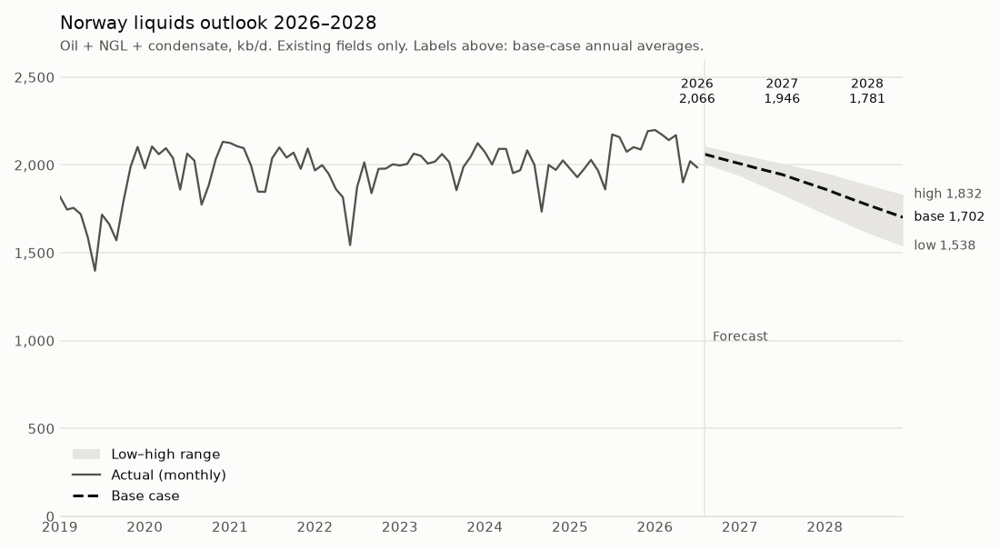

# Norwegian liquids supply outlook 2026–2028

A field-level forecast of Norwegian oil, NGL and condensate production, built from public Sodir data. Decline models per field and per field group are rolled up into a national supply view with low, base and high cases.

**On existing fields, Norwegian liquids output peaks in 2026 at about 2.07 mb/d and falls to 1.78 mb/d in 2028.** Johan Sverdrup has left plateau and the mature-field base declines by about 10% a year. New 2027 start-ups (Yggdrasil, Sverdrup Phase 3) are upside and are not included.



**Read the one-page outlook with the interactive chart: [fedorkoondrej.github.io/norway-liquids-forecast/reports/norway_liquids_outlook.html](https://fedorkoondrej.github.io/norway-liquids-forecast/reports/norway_liquids_outlook.html)**

## Results

Annual average liquids output, kb/d. 2026 combines actual January–July with forecast August–December.

| Case | 2025 actual | 2026 | 2027 | 2028 |
|---|---:|---:|---:|---:|
| Low | 2,044 | 2,040 | 1,839 | 1,625 |
| **Base** | **2,044** | **2,066** | **1,946** | **1,781** |
| High | 2,044 | 2,086 | 2,013 | 1,894 |

Base case by component, kb/d:

| Component | 2025 actual | 2026 | 2027 | 2028 |
|---|---:|---:|---:|---:|
| Johan Sverdrup | 704 | 649 | 608 | 569 |
| Johan Castberg | 108 | 184 | 188 | 178 |
| Mature fields (83) | 954 | 849 | 772 | 696 |
| Young and redeveloped (12) | 278 | 383 | 378 | 339 |
| **Norway** | **2,044** | **2,066** | **1,946** | **1,781** |

## How it works

Each step is one notebook, run in order.

| Step | Notebook | What it does |
|---|---|---|
| 1 | [01_ingest](notebooks/01_ingest.ipynb) | Downloads Sodir's monthly field production CSV and saves a dated raw snapshot. |
| 2 | [02_load_mysql](notebooks/02_load_mysql.ipynb) | Loads the snapshot unchanged into a MySQL **bronze** table. |
| 3 | [03_clean](notebooks/03_clean.ipynb) | Builds **silver** SQL views: readable names, real dates, kb/d rates, and a status flag for negative (accounting correction) and zero months. |
| 4 | [04_explore](notebooks/04_explore.ipynb) | Ranks fields, measures concentration, and classifies each field as declining, plateau or ramping up. |
| 5 | [05_forecast](notebooks/05_forecast.ipynb) | Forecasts each component and saves the result as **gold** table and view in MySQL. |
| 6 | [06_backtest](notebooks/06_backtest.ipynb) | Tests the mature-field decline method against history. |

Shared forecasting functions (Arps decline, plateau model, field grouping) are in [notebooks/forecast_tools.py](notebooks/forecast_tools.py).

### Forecast method

| Component | Share of 2025 output | Model |
|---|---:|---|
| Johan Sverdrup | 34% | Arps decline fitted from the end of the Phase 2 plateau. Cases differ in decline start (2024–25) and b (0.01–1.0). |
| Johan Castberg | 5% | Capacity (median of normal months, 205 kb/d; nameplate 220 kb/d) × uptime, flat to an assumed plateau end, then exponential decline. Outage months are excluded from capacity. |
| Mature fields | 47% | One Arps curve fitted to the summed output of 83 declining fields. Individual fits were too noisy (median R² 0.08). |
| Young and redeveloped | 14% | Same plateau model as Castberg, on the median rate of the last six producing months. Includes old fields rising again after redevelopment, such as Balder X. |

Units: 1 Sm³ = 6.2898 bbl, monthly volume divided by days in the month.

### Validation

- **Out of sample:** for August 2026, the first forecast month, the base case gives 2,061 kb/d. Sodir's preliminary figure is 2,073 kb/d (−0.6%).
- **Backtest:** the mature-field method was rerun from five past starting points (June 2020 to June 2024) using only the data known at the time. With a three-year fit window, the average error was 3.1% one year ahead and 5.3% two years ahead, with almost no bias in the first year. A five-year window overstated output at every starting point, so it is used only for the high case.

### Main judgement calls

- Johan Sverdrup is treated as declining from 2024–25. Monthly output fell from 691 kb/d (December 2025) to 610 kb/d (July 2026).
- Castberg's drops in November–December 2025 and June–July 2026 are treated as outages, not decline.
- Fields that are below 85% of their all-time peak but grew at least 20% and 5 kb/d in the last year count as redeveloped, not mature.

### Limitations

- **Existing fields only.** Projects due in 2026–2027 (Yggdrasil, Johan Sverdrup Phase 3, Valhall PWP-Fenris, Skarv Satellites) are not modelled, so 2027–2028 is a floor rather than a central estimate.
- **Johan Sverdrup may be declining faster.** June (636 kb/d) and July 2026 (610 kb/d) sit below all three cases. If those months were not turnarounds, the low case is closer.
- Plateau lengths and uptime for young fields are assumptions, not fits.
- Arps curves do not capture end-of-life shut-ins; the backtest suggests this is why longer fit windows overstate mature output.

## Run it yourself

Requirements: Python 3.13, a local MySQL server (8.0 or later), and a MySQL user with permission to create databases.

```bash
python3 -m venv .venv
source .venv/bin/activate
pip install -r requirements.txt
```

Open the notebooks in order with the `.venv` kernel. The first cell of each notebook sets the MySQL `username` (`root` by default; change it to your own user) and asks for the password when it connects; the password is never stored. Notebook 02 creates the `norway_forecast` database.

If you use the python.org installer for Python on macOS and the download in notebook 01 fails with `CERTIFICATE_VERIFY_FAILED`, run `Install Certificates.command` from the Python folder in Applications once.

## Repository structure

```
data/raw/        dated raw snapshot from Sodir (never edited)
notebooks/       one notebook per step, plus forecast_tools.py
reports/         one-page outlook (HTML) and chart
```

## Data

[Sodir FactPages](https://factpages.sodir.no/en/field/TableView/Production/Saleable/Monthly), monthly saleable production by field, snapshot of 13 October 2026 (136 fields, June 1971 to July 2026). Published by the Norwegian Offshore Directorate under the Norwegian Licence for Open Government Data (NLOD).

## Author

Ondrej Fedorko, petroleum engineer (production engineering, decline analysis).
